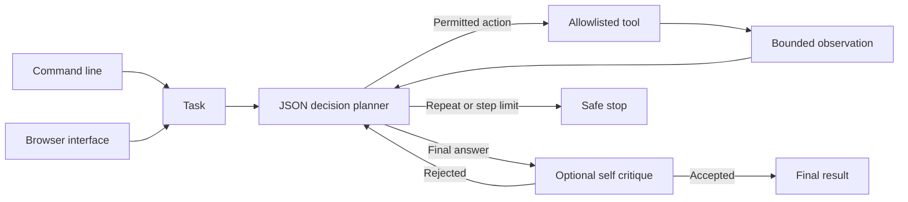

# React Planning Agent

Run a bounded observe, reason, act loop over an explicit tool allowlist with repeat detection and graceful tool failure.

Pass a `critic(task, proposed_answer, steps)` callback to reject an unsupported final answer and return targeted feedback. Revisions count against `max_steps`.

## Quick start

Requires Python 3.11 or newer. From this repository:

```powershell
python -m venv .venv
.\.venv\Scripts\Activate.ps1
python -m pip install -e '.[dev]'
pytest -q
```

On macOS or Linux:

```bash
python3 -m venv .venv
source .venv/bin/activate
python -m pip install -e '.[dev]'
pytest -q
```

For live model calls, set `OPENAI_API_KEY` and optionally `OPENAI_MODEL` and `OPENAI_BASE_URL` as shown in `.env.example`. The test suite uses stubs and needs no model key.

The installed `react-planner` command answers tasks using only three built-in tools: bounded arithmetic, read-only files under `--root`, and bounded text search under that root. Run `react-planner --root ./docs run "Find the refund terms and summarize them"`. For the local browser, run `react-planner --root ./docs serve --port 8080` and open `http://127.0.0.1:8080`. Set `OPENAI_API_KEY` for either mode. The agent exposes its step trace and stop reason in the result.

```python
from react_planning_agent.engine import ReActAgent
from react_planning_agent.llm import OpenAICompatibleLLM

agent = ReActAgent(OpenAICompatibleLLM.from_env(), {"lookup": lambda key: {"a": "Found A"}.get(key, "Missing")}, max_steps=4)
print(agent.run("Look up a and answer"))
```

## Architecture



| Component | Responsibility |
|---|---|
| Planner | Chooses one JSON action or final answer per step. |
| Tool boundary | Runs only registered handlers and truncates observations. |
| Stop controller | Enforces iteration limits and repeated action detection. |

Task -> JSON action decision -> permitted tool -> bounded observation -> reflection -> final answer or configured stop reason.

See [ARCHITECTURE.md](ARCHITECTURE.md) for components, state, failure behavior, and operations.

## Deployment and safety

See [DEPLOYMENT.md](DEPLOYMENT.md) for the non-root container, token-protected browser, data mounts, and release checks.

Tool handlers are trusted application code. Register read only handlers by default, enforce authorization inside handlers, and set network and execution timeouts. Tool exceptions are reduced to class names in observations.

Install this as a library in an authenticated application or worker. Supply the LLM adapter through dependency injection. Keep secrets in environment variables, never in source control.

## Verification

`pytest -q` runs deterministic tests. GitHub Actions runs the same suite on pushes and pull requests.

## License

MIT. See [LICENSE](LICENSE).
