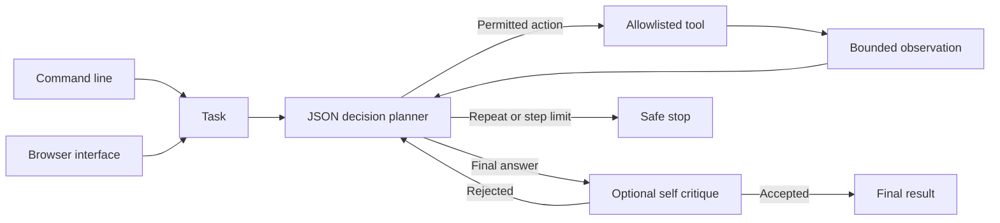

# React Planning Agent

## About

This is a task assistant that can take a few deliberate steps instead of guessing from a single prompt. It can search or read files inside a folder you choose and do bounded arithmetic. After each tool result, it decides whether to continue or answer. You can inspect the steps it took and why it stopped.

### What you can do

- Ask questions about a local set of documents, such as finding a policy and summarizing it.
- Limit the number of steps so a task cannot run indefinitely.
- Restrict the assistant to the tools and folder you explicitly provide.
- Add a critic callback that asks for a revision when a final answer is unsupported.

The CLI and local browser are ready to run on your machine or your own server. They need a configured model key for live answers. The supplied tools are read-only, and custom tools should enforce their own permissions and timeouts. This repository does not have a public hosted URL yet.

## Quick start

Requires Python 3.11 or newer. From this repository:

```powershell
python -m venv .venv
.\.venv\Scripts\Activate.ps1
python -m pip install -e '.[dev]'
pytest -q
```

On macOS or Linux:

```bash
python3 -m venv .venv
source .venv/bin/activate
python -m pip install -e '.[dev]'
pytest -q
```

For live model calls, set `OPENAI_API_KEY` and optionally `OPENAI_MODEL` and `OPENAI_BASE_URL` as shown in `.env.example`. The test suite uses stubs and needs no model key.

The installed `react-planner` command answers tasks using only three built-in tools: bounded arithmetic, read-only files under `--root`, and bounded text search under that root. Run `react-planner --root ./docs run "Find the refund terms and summarize them"`. For the local browser, run `react-planner --root ./docs serve --port 8080` and open `http://127.0.0.1:8080`. Set `OPENAI_API_KEY` for either mode. The agent exposes its step trace and stop reason in the result.

```python
from react_planning_agent.engine import ReActAgent
from react_planning_agent.llm import OpenAICompatibleLLM

agent = ReActAgent(OpenAICompatibleLLM.from_env(), {"lookup": lambda key: {"a": "Found A"}.get(key, "Missing")}, max_steps=4)
print(agent.run("Look up a and answer"))
```

## Architecture



| Component | Responsibility |
|---|---|
| Planner | Chooses one JSON action or final answer per step. |
| Tool boundary | Runs only registered handlers and truncates observations. |
| Stop controller | Enforces iteration limits and repeated action detection. |

Task -> JSON action decision -> permitted tool -> bounded observation -> reflection -> final answer or configured stop reason.

See [ARCHITECTURE.md](ARCHITECTURE.md) for components, state, failure behavior, and operations.

## Deployment and safety

See [DEPLOYMENT.md](DEPLOYMENT.md) for the non-root container, token-protected browser, data mounts, and release checks.

Tool handlers are trusted application code. Register read only handlers by default, enforce authorization inside handlers, and set network and execution timeouts. Tool exceptions are reduced to class names in observations.

Install this as a library in an authenticated application or worker. Supply the LLM adapter through dependency injection. Keep secrets in environment variables, never in source control.

## Verification

`pytest -q` runs deterministic tests. GitHub Actions runs the same suite on pushes and pull requests.

## Product guide

### A typical run

Point the app at a folder of documents with `--root`, then ask a question such as “Find the refund terms and summarize them.” The planner may search filenames or text, read a matching file, and then produce an answer. Its result includes the tool steps and a stop reason, so you can see whether it answered, ran out of steps, repeated an action, or encountered a tool problem.

| Built-in tool | What it can do | Boundary |
|---|---|---|
| File read | Read a file under the configured root | Read only; path must stay under that root |
| Text search | Find bounded matches under that root | Result size is limited |
| Calculator | Evaluate basic arithmetic | Expression length and operators are limited |

The agent cannot install software, write files, run arbitrary commands, or browse the web through these built-in tools. If you integrate another handler, it becomes part of your application's trusted code and must apply its own access checks and I/O timeouts.

### How the loop stops

The model chooses a structured action or a final answer at each step. Tool output is returned as an observation for the next decision. `max_steps` bounds the whole run, and repeated actions are detected so the agent cannot spin forever. A failing tool becomes a bounded observation rather than an unhandled crash. An optional `critic(task, proposed_answer, steps)` callback can reject an answer with feedback; the revision still counts against the step budget.

### Configuration and deployment

Set `OPENAI_API_KEY` for live planning, and optionally `OPENAI_BASE_URL` and `OPENAI_MODEL` for an OpenAI-compatible provider. Pick a narrow document root. Start the CLI with `react-planner --root ./docs run "..."` or the local browser with `react-planner --root ./docs serve --port 8080`. The browser is an operator interface; see [DEPLOYMENT.md](DEPLOYMENT.md) for token protection and container options before exposing it beyond localhost.

No task history is stored by the core agent. If you need an audit record, persist the returned step trace in your integrating application. Unit tests use a stub model to cover valid plans, limits, repeat detection, and tool failures without consuming model tokens. The app has no public Vercel deployment yet.

### Common issues

| Symptom | Check |
|---|---|
| A file cannot be read | Make sure it is under `--root`; paths outside that folder are intentionally blocked. |
| The agent stops before answering | Read its stop reason and step trace. Increase `max_steps` only if the extra work is justified. |
| It repeats a search | Narrow the task or improve the available documents; repeated actions are stopped on purpose. |
| Model calls fail | Check the provider key, HTTPS base URL, model ID, and quota. |

For a production integration, add domain-specific answer checks and log the bounded step trace without storing secrets from source files. The included local interface is a starting point for an authenticated deployment, not a shared public service.

## License

MIT. See [LICENSE](LICENSE).
